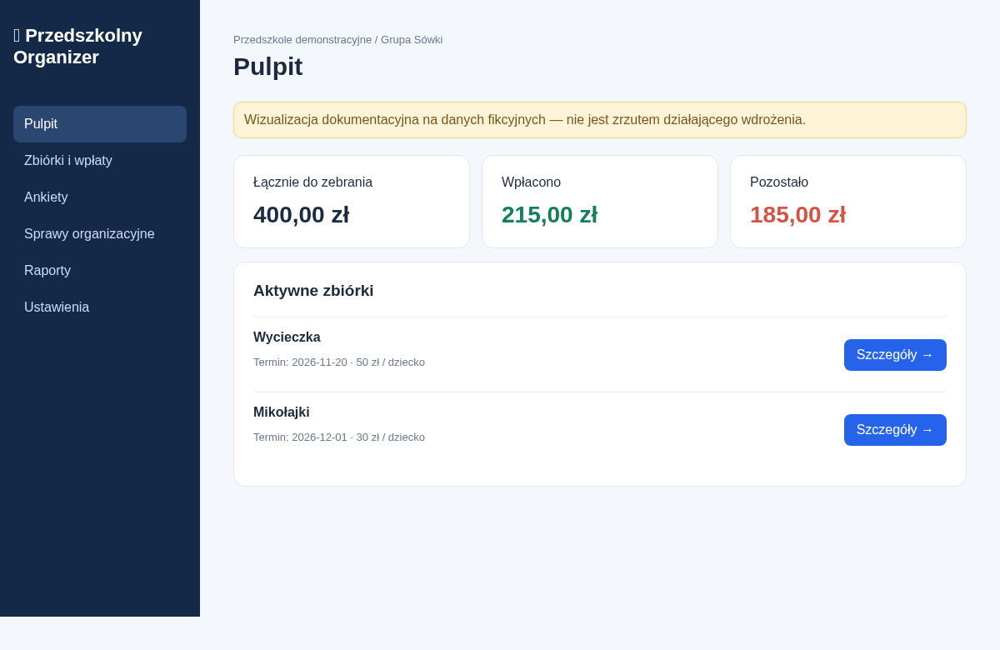
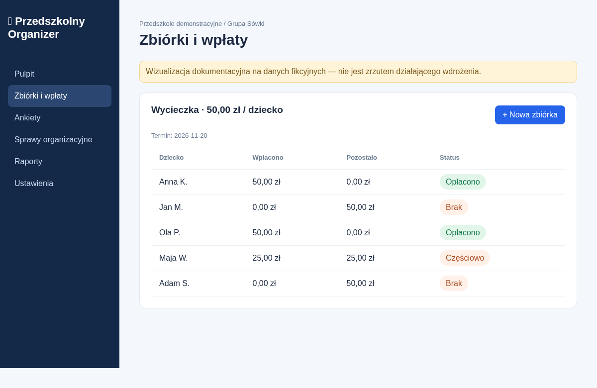
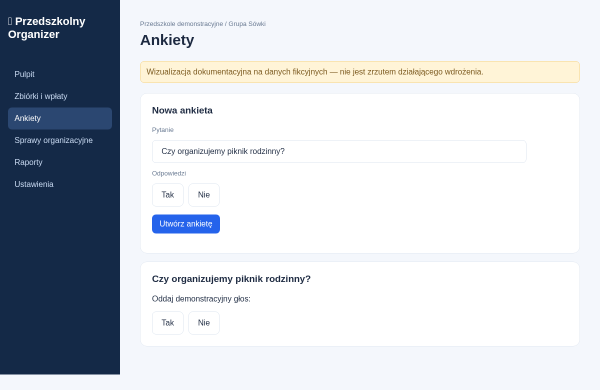
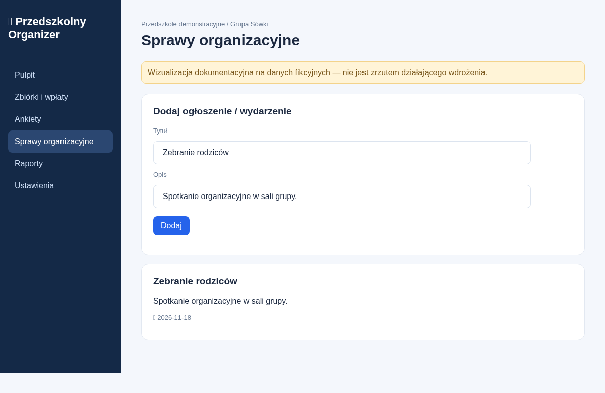

# 🏫 Przedszkolny Organizer

**Otwarty projekt aplikacji do obsługi zbiórek, wpłat, ankiet i organizacji życia grup przedszkolnych.**

> ⚠️ **Status: prototyp interfejsu (nieprodukcyjny).** Obecnie nie ma backendu, logowania ani trwałej bazy danych. Wszystkie dane widoczne w demonstracji są fikcyjne, a zmiany znikają po odświeżeniu. **Nie wprowadzaj danych rzeczywistych dzieci lub rodziców.**

## Podgląd ekranów

Poniższe obrazy są **wizualizacjami dokumentacyjnymi odtwarzającymi wygląd prototypu na fikcyjnych danych**, a nie automatycznymi zrzutami uruchomionej aplikacji React.

### Pulpit


### Zbiórki i wpłaty


### Ankiety


### Sprawy organizacyjne


## Dokumentacja

- [Funkcjonalności i scenariusze użytkowników](docs/FUNKCJONALNOSCI.md)
- [Architektura i model danych](docs/ARCHITEKTURA.md)
- [Uruchomienie i plan wdrożenia Cloudflare](docs/URUCHOMIENIE.md)
- [Bezpieczeństwo, prywatność i RODO](docs/BEZPIECZENSTWO.md)
- [Plan realizacji i kryteria akceptacji](docs/ROADMAP.md)

## Stos technologiczny

| Warstwa | Technologia | Status |
|---|---|---|
| Interfejs | React, TypeScript, CSS | Prototyp w kodzie |
| Build | Vite | Skonfigurowany, bez potwierdzonego buildu |
| Backend | Cloudflare Workers | Planowany; brak implementacji |
| Baza | Cloudflare D1 (SQLite) | Wstępny `schema.sql`, nieuruchomiona |
| PWA | Manifest | Jest; brak pełnej obsługi offline |
| Hosting | Cloudflare | Docelowy, niewdrożony |

## Uruchomienie lokalne

Wymagane: Node.js i npm oraz dostęp do pakietów npm.

```bash
npm install
npm run dev
```

Otwórz adres wskazany przez Vite (zwykle `http://localhost:5173`).

```bash
npm run build
npm run preview
```

**Uwaga:** `npm run deploy` nie jest jeszcze gotowy do użycia. W konfiguracji `wrangler.jsonc` znajduje się zastępczy identyfikator bazy D1, a plik `worker.js` nie istnieje.

## Struktura repozytorium

```text
przedszkolny-organizer/
├── README.md
├── docs/
│   ├── FUNKCJONALNOSCI.md
│   ├── ARCHITEKTURA.md
│   ├── URUCHOMIENIE.md
│   ├── BEZPIECZENSTWO.md
│   ├── ROADMAP.md
│   ├── make_previews.py
│   └── screenshots/
│       ├── pulpit.png
│       ├── wplaty.png
│       ├── ankiety.png
│       └── organizacja.png
├── src/
│   ├── main.tsx
│   └── style.css
├── public/manifest.webmanifest
├── schema.sql
├── wrangler.jsonc
├── vite.config.ts
├── tsconfig.json
├── package.json
└── index.html
```

## Zakres demonstracji

- Pulpit z sumami należności i wpłat dla przykładowych dzieci.
- Dodawanie zbiórek i częściowych wpłat w pamięci przeglądarki.
- Statusy: brak / częściowo / opłacono.
- Tworzenie prostych ankiet i jeden demonstracyjny głos.
- Ogłoszenia i wydarzenia z datą.
- Eksport danych przykładowych do CSV.
- Przełącznik grupy w UI **nie filtruje jeszcze danych**.

## Wizja produktu

Docelowo jedna platforma ma obsługiwać wiele niezależnych przedszkoli (multi-tenant). Każda placówka ma własne grupy, rodziców, dzieci i uprawnienia. Rodzic widzi własne rozliczenia, skarbnik rozliczenia przypisanej grupy, administrator placówki zarządza wyłącznie własną placówką. Izolacja danych musi być egzekwowana w API, nie tylko w interfejsie.

## Licencja i wkład

Licencja nie została jeszcze wybrana. Przed publicznym udostępnieniem repozytorium należy dodać odpowiedni plik `LICENSE`, politykę zgłaszania podatności i zasady współpracy.
