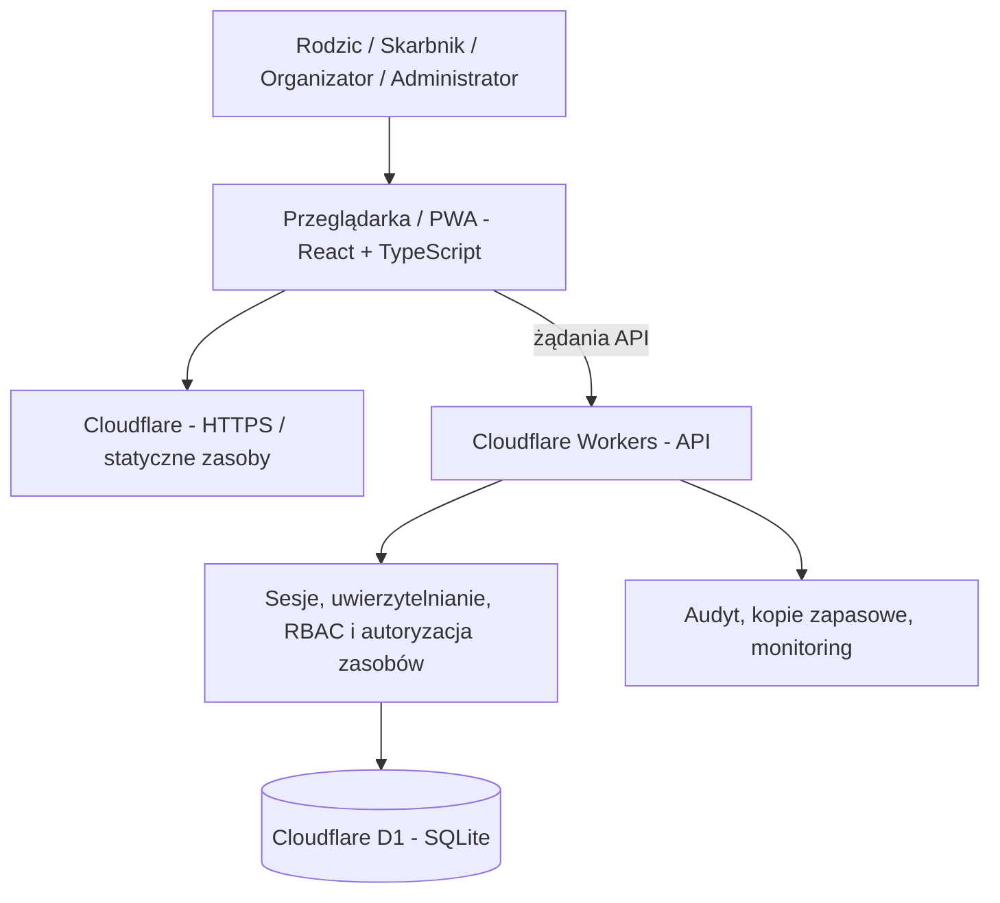
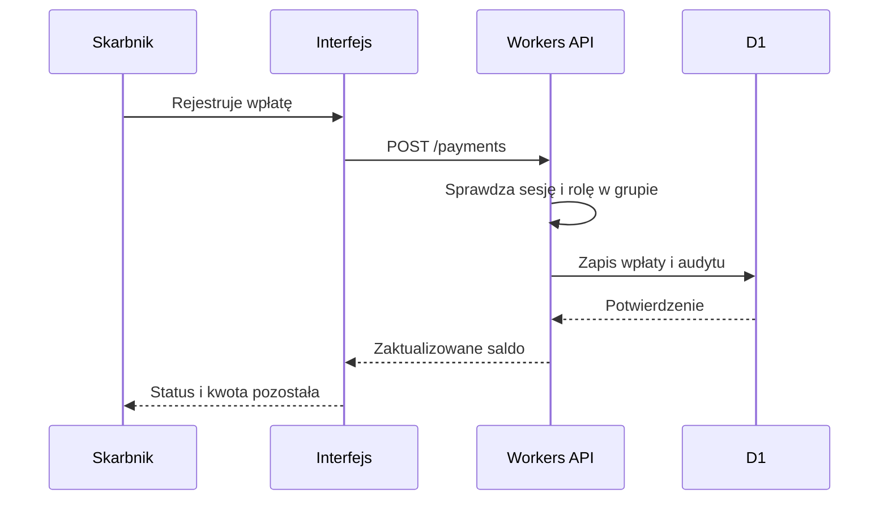

# Architektura techniczna

## 1. Stan aktualny a architektura docelowa

**Aktualnie:** aplikacja SPA w `src/main.tsx` z lokalnym stanem React; dane testowe zaszyte w kodzie. Nie istnieje API, serwer uwierzytelniania ani trwały zapis. `schema.sql` to projekt struktury, nie uruchomiona baza. `wrangler.jsonc` jest szkicem wdrożeniowym.

**Docelowo:** multi-tenant SaaS na Cloudflare z izolacją przedszkoli, backendem Workers, D1 i kontrolą uprawnień.

## 2. Diagram logiczny (projekt)



Diagram przedstawia **projekt**, nie stan wdrożenia.

## 3. Warstwy

### Frontend

- React + TypeScript, Vite, responsywny CSS.
- Widoki: pulpit, zbiórki, ankiety, organizacja, raporty, ustawienia.
- Wersja docelowa: routing, obsługa sesji, stany ładowania i błędów, walidacja, dostępność WCAG.
- PWA: obecnie wyłącznie manifest, bez cache offline i powiadomień push.

### API / logika biznesowa (do zbudowania)

- Cloudflare Workers jako brama API.
- Każda operacja identyfikuje użytkownika na podstawie zweryfikowanej sesji.
- `school_id` i zakres grup wyprowadzane z autoryzacji, nie przyjmowane bezkrytycznie od klienta.
- Walidacja wejścia, ograniczanie żądań, dziennik zdarzeń, idempotencja zapisu wpłat.
- Przykładowe przyszłe endpointy (kontrakt do zatwierdzenia):

```text
GET    /api/me
GET    /api/schools/:schoolId/groups
GET    /api/groups/:groupId/collections
POST   /api/groups/:groupId/collections
POST   /api/collections/:collectionId/payments
GET    /api/collections/:collectionId/balances
GET    /api/groups/:groupId/polls
POST   /api/groups/:groupId/polls
POST   /api/polls/:pollId/votes
GET    /api/groups/:groupId/notices
POST   /api/groups/:groupId/notices
GET    /api/reports/collections.csv
```

Te ścieżki **nie działają** w aktualnym prototypie.

### Baza danych

- Docelowo D1 (SQLite), transakcje i migracje wersjonowane.
- Kwoty w bazie jako **liczby całkowite w groszach** (`amount_cents`), nie `float`.
- Identyfikatory UUID/losowe ID, daty w uzgodnionym formacie UTC.
- W każdej tabeli biznesowej klucz placówki; wszystkie zapytania sprawdzają zakres placówki i grupy.

## 4. Wstępny model danych

| Tabela | Znaczenie | Główne relacje |
|---|---|---|
| `schools` | Przedszkola | Tenant |
| `users` | Konta | Globalna tożsamość |
| `memberships` | Role w placówce | `users` → `schools` |
| `groups` | Grupy | `schools` |
| `children` | Dzieci | `schools`, `groups` |
| `guardians` | Relacja rodzic–dziecko | `users`, `children` |
| `collections` | Zbiórki | `schools`, `groups` |
| `payments` | Wpłaty | `collections`, `children`, `users` |
| `polls` | Ankiety | `schools`, `groups` |
| `votes` | Głosy | `polls`, `users` |
| `notices` | Ogłoszenia | `schools`, `groups` |
| `audit_log` | Ślad audytowy | `schools`, aktor, operacja |

Pełny szkic DDL: [`schema.sql`](../schema.sql).

### Braki modelu do rozwiązania

1. Ograniczenia kluczy obcych nie gwarantują same w sobie, że `school_id` powiązanych rekordów jest zgodny — trzeba użyć dodatkowych kluczy złożonych, kontroli aplikacyjnych i testów.
2. Role skarbnika/organizatora są na poziomie placówki, a potrzebne są również przypisania do grup.
3. Brakuje tabel należności per dziecko, zwolnień, korekt, zwrotów, zaproszeń, sesji, dokumentów i powiadomień.
4. Anonimowe głosowania wymagają oddzielenia kontroli uprawnienia do głosowania od przechowywania odpowiedzi.
5. Trzeba określić politykę usuwania i archiwizacji danych na koniec roku szkolnego.

## 5. Izolacja tenantów

**Zasada:** każdy odczyt i zapis musi być autoryzowany w kontekście konkretnego przedszkola i grupy.

- Sesja → użytkownik → członkostwo w przedszkolu → uprawnienia do grupy → rekord.
- Brak dostępu między placówkami nawet przy odgadnięciu ID rekordu.
- Rodzic może odczytać wyłącznie własne powiązania `guardians`.
- Skarbnik może przeglądać finanse wyłącznie przypisanych grup.
- Testy negatywne na każdej trasie API (IDOR, privilege escalation).

## 6. Proces rozliczenia



## 7. Skalowanie i koszty

- Cel: działanie MVP w darmowych limitach Cloudflare; **nie jest to gwarancja 0 zł przy dowolnym ruchu**.
- Weryfikować aktualne limity Workers, D1 i zasobów statycznych przed wdrożeniem.
- Monitorować żądania, operacje D1, pojemność i błędy.
- Opcjonalne płatne elementy: domena, e-mail, SMS, przechowywanie plików, zewnętrzny operator płatności.
- Zaplanować możliwość migracji bazy i eksportu danych.

## 8. Decyzje projektowe do utrwalenia (ADR)

- ADR-001: multi-tenant na jednej bazie z logiczną izolacją tenantów.
- ADR-002: kwoty w groszach jako integer.
- ADR-003: historia wpłat nieusuwalna logicznie; korekty jako nowe zdarzenia.
- ADR-004: domyślna minimalizacja danych i uprawnień.
- ADR-005: najpierw działające API i bezpieczeństwo, dopiero potem publikacja.
